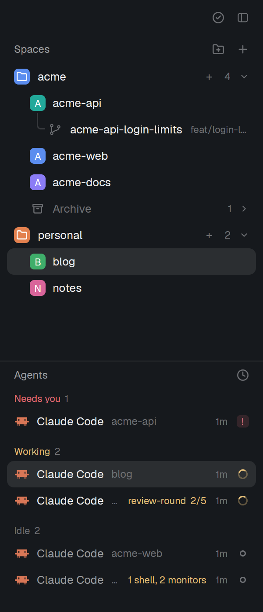
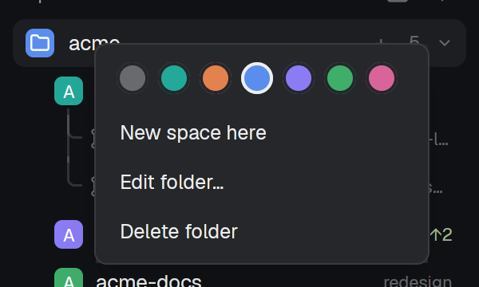
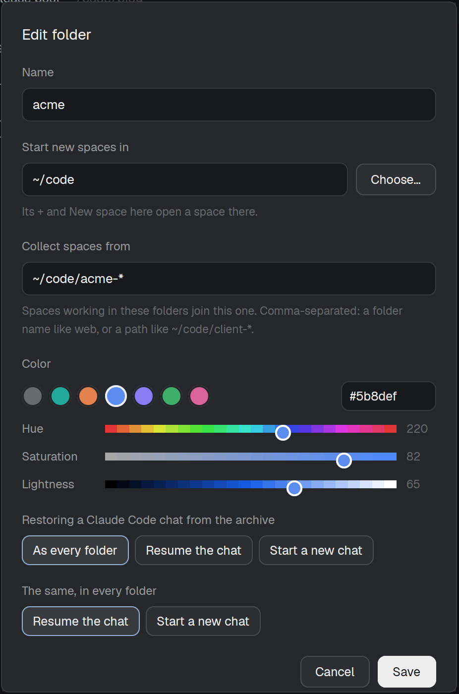
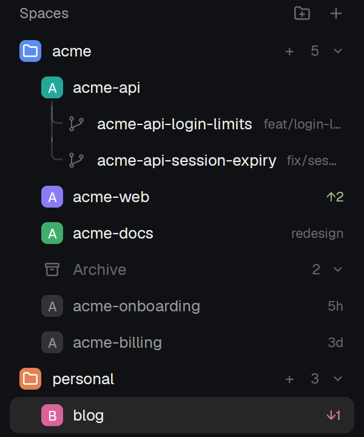
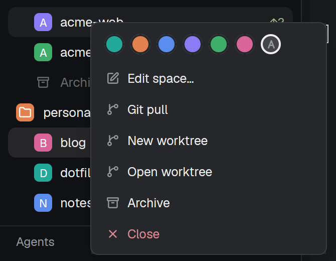
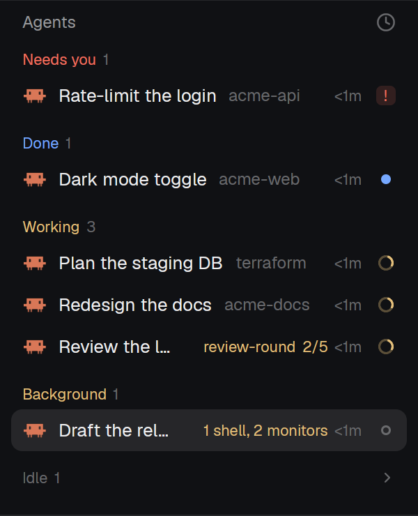
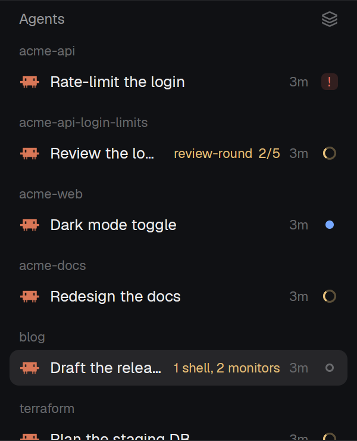
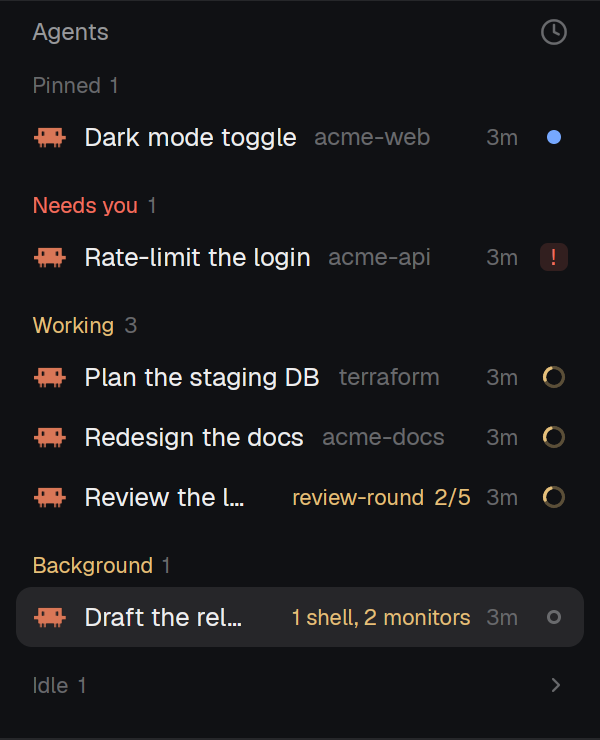

# herdr-mods

Three mods and a layout for the [Herdr](https://herdr.dev) desktop app (`herdr-app`): a spaces list with folders, and an agents list that shows what a Claude Code agent still runs in the background and holds its finish alert until it really finished.

Listed in the [Herdr gallery](https://herdr.dev/gallery/) under Community.



# Short instructions for your AI agent

```text
Read https://github.com/Danipulok/herdr-mods and install it into my Herdr app, with the requirements its README lists
```

## What is in it

- `mods/folders` replaces the spaces list with folders.
- `mods/agent-list` replaces the agents list with one sorted by what needs you, and rings a finished agent only once it stayed done.
- `mods/toast-filter` is Herdr's toast mod, holding back Herdr's own finish toast for `agent-list` and writing every notification to a log file.
- `layouts/my-t3.json` is the `herdr-t3` layout with its spaces block pointed at `folders` and its agents block at `agent-list`, and its notifications drawn by `toast-filter`.
- `keys.json` holds the keys of the `layout:my-t3` section.
- `settings.json` points Herdr's done sound at a silent file, since `agent-list` plays it.

[`RECIPE.md`](RECIPE.md) describes the same features in the form an agent rebuilds them from: sizes, colors and the commands each mod runs.

## Features

<details>
<summary><b>Folders</b>: name, color, rules that collect spaces, a start folder</summary>




- New folder from the `folder-plus` button at the top of the list.
- A folder head shows a colored tile, the name, a `+` for a new space in it, the count of its spaces and a fold arrow. Click the head to fold it.
- Folded, the head still shows the most urgent agent state of its spaces (a spinner or a dot).
- Drag a head to reorder folders.
- Right-click a head: color swatches, New space here, Edit folder…, Delete folder.
- Edit folder:
  - Name.
  - Start new spaces in: the directory its `+` and New space here open a space in, with Choose… and path completion. A path that is not a directory shows an error.
  - Collect spaces from: comma-separated rules. `~` is any home, `*` is one directory name, a bare name (`web`) matches at any depth, the deepest match wins. It follows the start folder until you edit it.
  - Color: the presets and grey, a `#rrggbb` field, and hue, saturation and lightness sliders, each track drawn in the colors it gives.
  - Restoring a Claude Code chat from the archive: as every folder, resume it, or start a new one; and the same for every folder.
  - Tab and Shift+Tab move between fields; Up, Down and Tab pick a completion.
- Delete a folder and its spaces go where the other folders' rules put them.
- The folders live in `~/.config/herdr-space-folders.json`, the file [herdr-space-folders](https://github.com/jankeesvw/herdr-space-folders) uses, so folders made with that mod show up here. A newer file on disk wins, and the file is re-read every 15 seconds and on change.

</details>

<details>
<summary><b>Spaces</b>: git info, worktrees, drag and drop, a right-click menu</summary>




- Each space shows a colored avatar with its initial and, only when unusual, its git info: `repo · branch`, `↑2` in green, `↓1` in red. `main` and `master` are left out.
- Click a red `↓N` to pull.
- A linked worktree sits under its checkout with tree lines; the checkout's avatar becomes a fold arrow for its worktrees.
- Drag a space onto another to move it there and into that folder. While dragging, a "Drop here to take it out of its folder" zone shows.
- A space dropped into a folder by hand stays there, whatever the rules say.
- Right-click a space: color swatches with an automatic one, Edit space… (name, a pinned folder, empty to follow its terminals, its color with the same editor as Edit folder, and how its Claude Code chat restores), Git pull, New worktree, Open worktree, Remove worktree (linked ones), Archive, Close.
- A space made from the front one (keys, palette) lands right under it in the same folder; one made from a folder's `+` joins that folder. Closing the front space selects the one above it.
- Spaces of another machine get their own header, or sit inside the first folder whose rules match.
- Narrower than 160px, the list draws a compact rail of avatars.

</details>

<details>
<summary><b>Archive</b>: put a space away with its tabs, restore it later</summary>

- Archive a space from its right-click menu, the hover button, or `ctrl-shift-w` / `cmd-shift-w`. Each tab's name, directory and Claude Code session are recorded, then the space closes.
- A folder ends with an `Archive N` row. Open, it lists the archived spaces newest first with their age (`5h`, `3d`); see the Spaces screenshot. Archiving or restoring a space folds it.
- Hover an archived row for its restore button, Shift-click it to restore the other way; right-click it for both restores and Delete.
- Restore checks each directory still exists, opens the space and its tabs, and where a session was recorded runs `claude --resume <session>`, or a new `claude` in the folder the tab was in. Which one: the space's own choice, else its folder's, else the one for every folder (resume by default). Set them in Edit space…, in Edit folder…, or by right-clicking the `Archive` row. Sessions come from ccgram, see [Requirements](#requirements).

</details>

<details>
<summary><b>Agents</b>: sorted by what needs you, with background work and workflows</summary>





- Sections by priority: Needs you, Done, Working, Background, Idle, each with its count. Idle starts folded.
- Background holds idle and done agents that still run a shell, a monitor or a workflow, so a finished turn with work left behind it goes straight there.
- The sort button switches to grouping by space.
- Each row: what the agent is on (its tab name, a telling title, else the program), its space when the section does not say it, the machine for a remote agent, the time in its state, and a state mark: a spinner, a `!` badge, a dot or a ring.
- For a Claude Code agent the list reads its footer every 5 seconds and shows what still runs behind it (`1 shell, 2 monitors`) and each running workflow with its steps done (`review-round 2/5`).
- Sub-agents sit under their parent with tree lines; the parent's fold arrow hides them and shows their count. A parent reads blocked if any sub-agent is.
- A done agent you look at stays in Done until you leave it.
- Hover a row to pin it. Pinned agents go into a Pinned group on top, the same pins herdr-t3's inbox uses.
- Click a row to focus the agent.
- A finish alert (toast and sound) waits 3 seconds and is dropped if by then the agent works again, you looked at it, or its footer shows a shell, a monitor or a workflow still running: Claude Code often finishes a turn and starts the next at once. Needs the Herdr version under Requirements.
- Every notification, gone in a few seconds on screen, stays in `~/.local/state/herdr-mods/notifications.jsonl` (under `$XDG_STATE_HOME` when set), one JSON line each, while the layout draws them with `toast-filter` (`my-t3` does). Each held finish alert adds a line saying whether it rang, and if not, why, and an error banner a mod of this repo flashes adds its message and stack.

</details>

<details>
<summary><b>Updates</b>: a toast when a new release is out, installed by one button</summary>

- Every 6 hours the folders mod asks GitHub for the newest release (`api.github.com`, no token) and compares it with the installed version.
- When a newer one is out, a toast at the bottom right says so, at most once a day. Click it for the update dialog.
- Update downloads that release into `~/.cache/herdr-mods/<version>` (or `$XDG_CACHE_HOME/herdr-mods`) and runs its `just deploy`; it needs `curl` and `tar` besides the [requirements](#requirements). A toast says when the new version is running.
- If that fails, or with Use an agent, the dialog shows a prompt to give an agent in a new space, with Copy and Copy and open a new space.
- Stop checking turns the checks off; `herdr-app do folders.check-updates` turns them on again and checks at once.

</details>

<details>
<summary><b>Keys</b>: walk the spaces in list order, archive the front one, make one in its folder</summary>

| Keys | Does |
| --- | --- |
| `alt-down`, `ctrl-shift-pagedown`, `ctrl-space shift-n` | Next space in list order, skipping folded folders |
| `alt-up`, `ctrl-shift-pageup`, `ctrl-space shift-p` | Previous space |
| `cmd-shift-w`, `ctrl-shift-w` | Archive the front space |
| `alt-shift-s` | New space in the front space's folder, started in its start folder, as the folder's `+` |
| `cmd-shift-b` | Show or hide the sidebar (herdr-t3) |
| `cmd-shift-a` | Switch between the tab and the agent view (herdr-t3) |
| `cmd-shift-s` | Settle an agent in the inbox (herdr-t3) |
| `ctrl-v` | Paste into the terminal |
| `ctrl-shift-t` | New tab |

</details>

## Requirements

- The Herdr desktop app with its `herdr-app` CLI. Tested with `herdr-app 0.1.14`; held finish alerts need `herdr-app 0.1.16`, whose layouts name their toast mod; on older versions alerts stay immediate.
- The `t3-*` mods of [herdr-t3](https://github.com/JinJieBeWater/herdr-t3), installed as its README says: the layout uses its `t3-chrome`, `t3-tabs` and `t3-inbox` mods.
- [`just`](https://github.com/casey/just) and [`jq`](https://jqlang.org).

Optional: with [ccgram](https://github.com/alexei-led/ccgram) installed, an archived Claude Code tab is resumed in its session on Restore. Without it, Restore opens a plain terminal in the same folder.

## Install

```sh
git clone https://github.com/Danipulok/herdr-mods
cd herdr-mods
just deploy
herdr-app do layout.switch --name my-t3
```

`just deploy` loads each mod once with `herdr-app check`, copies the mods and the layout into `~/.config/herdr-app` (or `$XDG_CONFIG_HOME/herdr-app`) and merges `keys.json` into the app's `keys.json` and, on the Herdr version held finish alerts need and unless you set your own done sound, `settings.json` into the app's `settings.json`. A running app picks up a deployed mod at once, with no restart. Run `just deploy` again after a `git pull` to update.

## Undo

1. Switch back to the default layout:
   ```sh
   herdr-app do layout.switch --name main
   ```
2. Delete what `just deploy` copied:
   ```sh
   rm -r ~/.config/herdr-app/mods/folders ~/.config/herdr-app/mods/agent-list ~/.config/herdr-app/mods/toast-filter ~/.config/herdr-app/layouts/my-t3.json
   ```
3. Drop the layout's keys:
   ```sh
. Give Herdr its done sound back:
   ```sh
   jq 'del(.sounds.done)' ~/.config/herdr-app/settings.json > settings.tmp && mv settings.tmp ~/.config/herdr-app/settings.json
   ```

Your folders stay in `~/.config/herdr-space-folders.json`. Delete that file too if no other mod uses it.

## Where the code comes from

| Part | Source | Commit |
|---|---|---|
| `mods/folders` base | [jankeesvw/herdr-space-folders](https://github.com/jankeesvw/herdr-space-folders) `mods/space-folders` | `d630695db04d852ec89d86dd284f603d133dbba5` |
| T3 changes in `mods/folders` | [JinJieBeWater/herdr-t3](https://github.com/JinJieBeWater/herdr-t3) `mods/t3-spaces` | `8b8506341a3aa285041f32e757bd48ef67c916bb` |
| `mods/agent-list` base | [JinJieBeWater/herdr-t3](https://github.com/JinJieBeWater/herdr-t3) `mods/t3-agents` | `8b8506341a3aa285041f32e757bd48ef67c916bb` |
| `layouts/my-t3.json` | [JinJieBeWater/herdr-t3](https://github.com/JinJieBeWater/herdr-t3) `layouts/herdr-t3.json` | `8b8506341a3aa285041f32e757bd48ef67c916bb` |
| Both of the above | [herdrdev/herdr-app](https://github.com/herdrdev/herdr-app) `defaults/mods/spaces` and `defaults/layouts/main.json` | tag `v0.1.10` |
| `mods/toast-filter` and `mods/agent-list/done.mp3` | [herdrdev/herdr-app](https://github.com/herdrdev/herdr-app) `defaults/mods/toast` and `assets/sounds/done.mp3` | tag `v0.1.16` (`034f8b85f7e6bb71f8ff55cb4a80c548b2578c0f`) |

Herdr's code and `herdr-t3` are under the Apache License 2.0 (`licenses/Apache-2.0`). The folders code of `herdr-space-folders` is MIT (`licenses/space-folders-MIT`).

To bring in an upstream change, diff the upstream file from the commit in the table to its new head and apply the hunks, then update the table.
