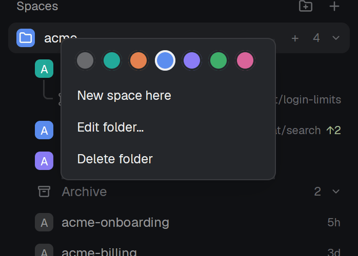
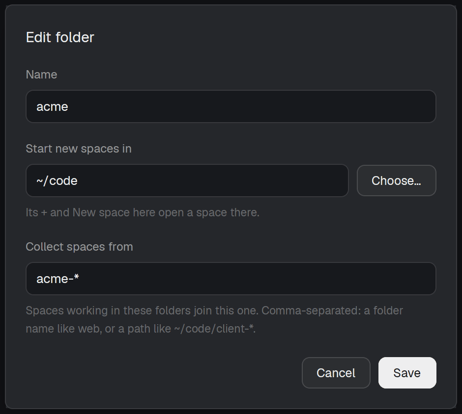
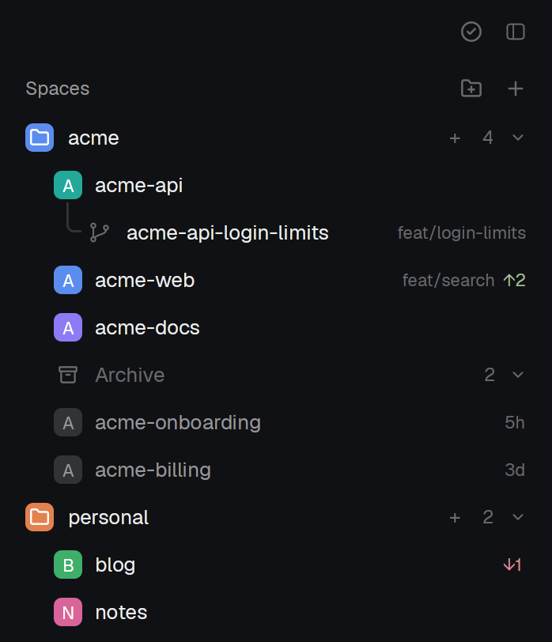
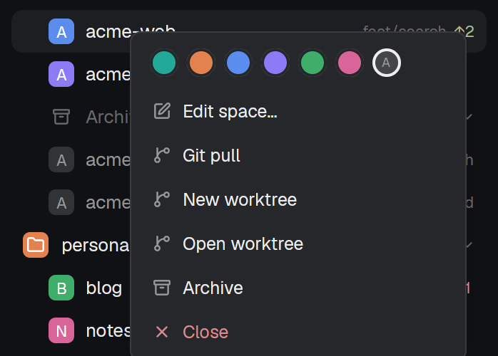
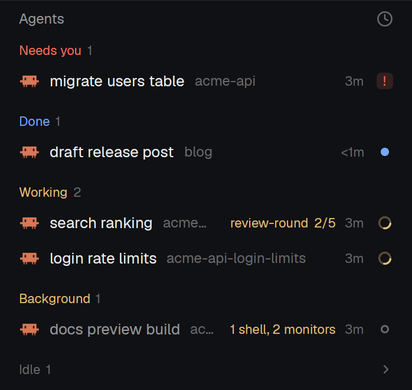
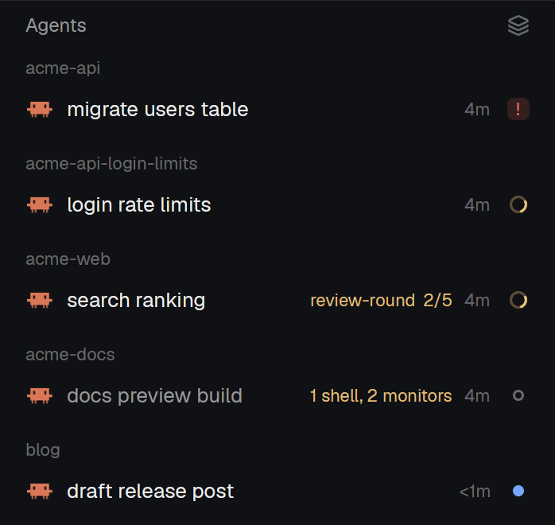
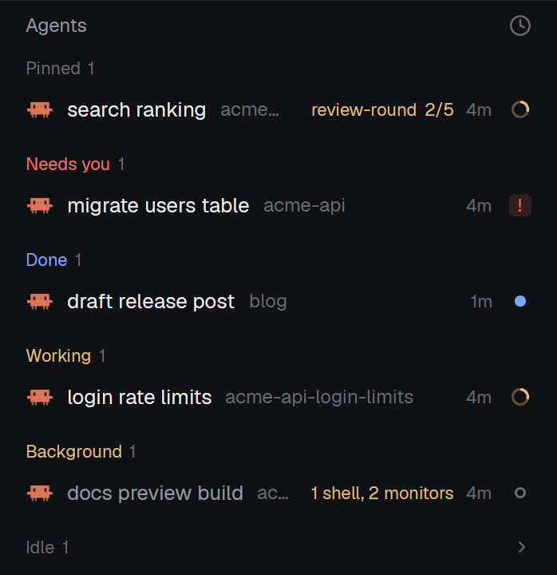

# herdr-mods

Two mods and a layout for the [Herdr](https://herdr.dev) desktop app (`herdr-app`): a spaces list with folders, and an agents list that shows what a Claude Code agent still runs in the background.

Listed in the [Herdr gallery](https://herdr.dev/gallery/) under Community.


# Short instructions for your AI agent

```text
Read https://github.com/Danipulok/herdr-mods and install it into my Herdr app, with the requirements its README lists
```

## What is in it

- `mods/folders` replaces the spaces list with folders.
- `mods/agent-list` replaces the agents list with one sorted by what needs you.
- `layouts/my-t3.json` is the `herdr-t3` layout with its spaces block pointed at `folders` and its agents block at `agent-list`.
- `keys.json` holds the keys of the `layout:my-t3` section.

[`RECIPE.md`](RECIPE.md) describes the same features in the form an agent rebuilds them from: sizes, colors and the commands each mod runs.

## Features

<details>
<summary><b>Folders</b>: name, color, rules that collect spaces, a start folder</summary>




- New folder from the `folder-plus` button at the top of the list.
- A folder head shows a colored tile, the name, a `+` for a new space in it, the count of its spaces and a fold arrow. Click the head to fold it.
- Folded, the head still shows the most urgent agent state of its spaces (a spinner or a dot).
- Drag a head to reorder folders.
- Right-click a head: color swatches, New space here, Edit folder…, Delete folder.
- Edit folder:
  - Name.
  - Start new spaces in: the directory its `+` and New space here open a space in, with Choose… and path completion. A path that is not a directory shows an error.
  - Collect spaces from: comma-separated rules. `~` is any home, `*` is one directory name, a bare name (`web`) matches at any depth, the deepest match wins. It follows the start folder until you edit it.
  - Tab and Shift+Tab move between fields; Up, Down and Tab pick a completion.
- Delete a folder and its spaces go where the other folders' rules put them.
- The folders live in `~/.config/herdr-space-folders.json`, the file [herdr-space-folders](https://github.com/jankeesvw/herdr-space-folders) uses, so folders made with that mod show up here. A newer file on disk wins, and the file is re-read every 15 seconds and on change.

</details>

<details>
<summary><b>Spaces</b>: git info, worktrees, drag and drop, a right-click menu</summary>




- Each space shows a colored avatar with its initial and, only when unusual, its git info: `repo · branch`, `↑2` in green, `↓1` in red. `main` and `master` are left out.
- Click a red `↓N` to pull.
- A linked worktree sits under its checkout with tree lines; the checkout's avatar becomes a fold arrow for its worktrees.
- Drag a space onto another to move it there and into that folder. While dragging, a "Drop here to take it out of its folder" zone shows.
- A space dropped into a folder by hand stays there, whatever the rules say.
- Right-click a space: color swatches with an automatic one, Edit space… (name and a pinned folder; empty means follow its terminals), Git pull, New worktree, Open worktree, Remove worktree (linked ones), Archive, Close.
- A space made from the front one (keys, palette) lands right under it in the same folder; one made from a folder's `+` joins that folder. Closing the front space selects the one above it.
- Spaces of another machine get their own header, or sit inside the first folder whose rules match.
- Narrower than 160px, the list draws a compact rail of avatars.

</details>

<details>
<summary><b>Archive</b>: put a space away with its tabs, restore it later</summary>

- Archive a space from its right-click menu, the hover button, or `ctrl-shift-w` / `cmd-shift-w`. Each tab's name, directory and Claude Code session are recorded, then the space closes.
- A folder ends with an `Archive N` row. Open, it lists the archived spaces newest first with their age (`5h`, `3d`); see the Spaces screenshot. Archiving or restoring a space folds it.
- Hover an archived row for its restore button; right-click it for Restore and Delete.
- Restore checks each directory still exists, opens the space and its tabs, and runs `claude --resume <session>` where a session was recorded. Sessions come from ccgram, see [Requirements](#requirements).

</details>

<details>
<summary><b>Agents</b>: sorted by what needs you, with background work and workflows</summary>





- Sections by priority: Needs you, Done, Working, Background, Idle, each with its count. Idle starts folded.
- Background holds idle and done agents that still run a shell, a monitor or a workflow, so a finished turn with work left behind it goes straight there.
- The sort button switches to grouping by space.
- Each row: what the agent is on (its tab name, a telling title, else the program), its space when the section does not say it, the machine for a remote agent, the time in its state, and a state mark: a spinner, a `!` badge, a dot or a ring.
- For a Claude Code agent the list reads its footer every 5 seconds and shows what still runs behind it (`1 shell, 2 monitors`) and each running workflow with its steps done (`review-round 2/5`).
- Sub-agents sit under their parent with tree lines; the parent's fold arrow hides them and shows their count. A parent reads blocked if any sub-agent is.
- A done agent you look at stays in Done until you leave it.
- Hover a row to pin it. Pinned agents go into a Pinned group on top, the same pins herdr-t3's inbox uses.
- Click a row to focus the agent.

</details>

<details>
<summary><b>Keys</b>: walk the spaces in list order, archive the front one</summary>

| Keys | Does |
| --- | --- |
| `alt-down`, `ctrl-shift-pagedown`, `ctrl-space shift-n` | Next space in list order, skipping folded folders |
| `alt-up`, `ctrl-shift-pageup`, `ctrl-space shift-p` | Previous space |
| `cmd-shift-w`, `ctrl-shift-w` | Archive the front space |
| `cmd-shift-b` | Show or hide the sidebar (herdr-t3) |
| `cmd-shift-a` | Switch between the tab and the agent view (herdr-t3) |
| `cmd-shift-s` | Settle an agent in the inbox (herdr-t3) |
| `ctrl-v` | Paste into the terminal |
| `ctrl-shift-t` | New tab |

</details>

## Requirements

- The Herdr desktop app with its `herdr-app` CLI. Tested with `herdr-app 0.1.14`.
- The `t3-*` mods of [herdr-t3](https://github.com/JinJieBeWater/herdr-t3), installed as its README says: the layout uses its `t3-chrome`, `t3-tabs` and `t3-inbox` mods.
- [`just`](https://github.com/casey/just) and [`jq`](https://jqlang.org).

Optional: with [ccgram](https://github.com/alexei-led/ccgram) installed, an archived Claude Code tab is resumed in its session on Restore. Without it, Restore opens a plain terminal in the same folder.

## Install

```sh
git clone https://github.com/Danipulok/herdr-mods
cd herdr-mods
just deploy
herdr-app do layout.switch --name my-t3
```

`just deploy` loads each mod once with `herdr-app check`, copies the mods and the layout into `~/.config/herdr-app` (or `$XDG_CONFIG_HOME/herdr-app`) and merges `keys.json` into the app's `keys.json`. A running app picks up a deployed mod at once, with no restart. Run `just deploy` again after a `git pull` to update.

## Undo

1. Switch back to the default layout:
   ```sh
   herdr-app do layout.switch --name main
   ```
2. Delete what `just deploy` copied:
   ```sh
   rm -r ~/.config/herdr-app/mods/folders ~/.config/herdr-app/mods/agent-list ~/.config/herdr-app/layouts/my-t3.json
   ```
3. Drop the layout's keys:
   ```sh
   jq 'del(.["layout:my-t3"])' ~/.config/herdr-app/keys.json > keys.tmp && mv keys.tmp ~/.config/herdr-app/keys.json
   ```

Your folders stay in `~/.config/herdr-space-folders.json`. Delete that file too if no other mod uses it.

## Where the code comes from

| Part | Source | Commit |
|---|---|---|
| `mods/folders` base | [jankeesvw/herdr-space-folders](https://github.com/jankeesvw/herdr-space-folders) `mods/space-folders` | `d630695db04d852ec89d86dd284f603d133dbba5` |
| T3 changes in `mods/folders` | [JinJieBeWater/herdr-t3](https://github.com/JinJieBeWater/herdr-t3) `mods/t3-spaces` | `8b8506341a3aa285041f32e757bd48ef67c916bb` |
| `mods/agent-list` base | [JinJieBeWater/herdr-t3](https://github.com/JinJieBeWater/herdr-t3) `mods/t3-agents` | `8b8506341a3aa285041f32e757bd48ef67c916bb` |
| `layouts/my-t3.json` | [JinJieBeWater/herdr-t3](https://github.com/JinJieBeWater/herdr-t3) `layouts/herdr-t3.json` | `8b8506341a3aa285041f32e757bd48ef67c916bb` |
| Both of the above | [herdrdev/herdr-app](https://github.com/herdrdev/herdr-app) `defaults/mods/spaces` and `defaults/layouts/main.json` | tag `v0.1.10` |

Herdr's code and `herdr-t3` are under the Apache License 2.0 (`licenses/Apache-2.0`). The folders code of `herdr-space-folders` is MIT (`licenses/space-folders-MIT`).

To bring in an upstream change, diff the upstream file from the commit in the table to its new head and apply the hunks, then update the table.
