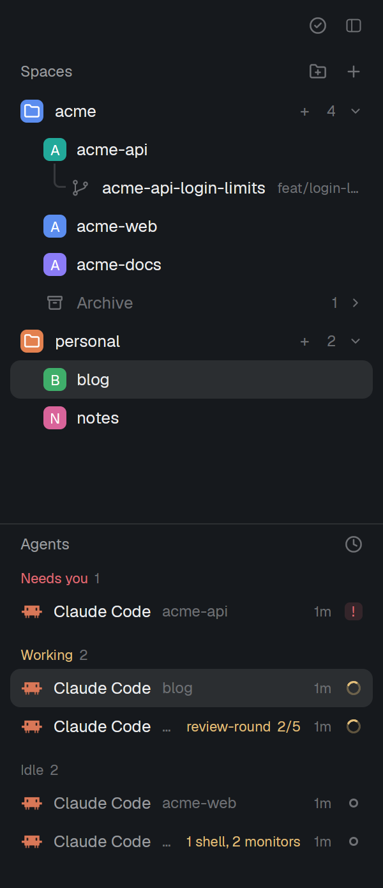

# herdr-mods

Two mods and a layout for the [Herdr](https://herdr.dev) desktop app (`herdr-app`): a spaces list with folders, and an agents list that shows what a Claude Code agent still runs in the background.

Listed in the [Herdr gallery](https://herdr.dev/gallery/) under Community.



# Short instructions for your AI agent

```text
Read https://github.com/Danipulok/herdr-mods and install it into my Herdr app, with the requirements its README lists
```

## What is in it

- `mods/folders` replaces the spaces list. You make folders, name and color them, and drag spaces into them. A folder can start its new spaces in a given directory and collect every space that works in a directory matching its rules (`web`, `~/code/client-*`). Worktrees sit under their checkout. Right-click a space to edit its name and folder, pull, make or open a worktree, archive it or close it. An archived space keeps its tabs and folders, and Restore opens it again.
- `mods/agent-list` replaces the agents list. It sorts agents by priority (needs you, done, working, background, idle) or groups them by space, and shows sub-agents under their parent. For a Claude Code agent it reads the footer every 5 seconds and shows what still runs behind it (`1 shell`, `2 monitors`) and each running workflow with its steps done (`0/8`).
- `layouts/my-t3.json` is the `herdr-t3` layout with its spaces block pointed at `folders` and its agents block at `agent-list`.
- `keys.json` holds the keys of the `layout:my-t3` section. `alt-up` and `alt-down` walk the spaces in folder order, and `ctrl-shift-w` or `cmd-shift-w` archives the space in front.

The folders are kept in `~/.config/herdr-space-folders.json`, the same file [herdr-space-folders](https://github.com/jankeesvw/herdr-space-folders) uses, so folders made with that mod show up here.

## Requirements

- The Herdr desktop app with its `herdr-app` CLI. Tested with `herdr-app 0.1.14`.
- The `t3-*` mods of [herdr-t3](https://github.com/JinJieBeWater/herdr-t3), installed as its README says: the layout uses its `t3-chrome`, `t3-tabs` and `t3-inbox` mods.
- [`just`](https://github.com/casey/just) and [`jq`](https://jqlang.org).

Optional: with [ccgram](https://github.com/alexei-led/ccgram) installed, an archived Claude Code tab is resumed in its session on Restore. Without it, Restore opens a plain terminal in the same folder.

## Install

```sh
git clone https://github.com/Danipulok/herdr-mods
cd herdr-mods
just deploy
herdr-app do layout.switch --name my-t3
```

`just deploy` loads each mod once with `herdr-app check`, copies the mods and the layout into `~/.config/herdr-app` (or `$XDG_CONFIG_HOME/herdr-app`) and merges `keys.json` into the app's `keys.json`. A running app picks up a deployed mod at once, with no restart. Run `just deploy` again after a `git pull` to update.

## Undo

1. Switch back to the default layout:
   ```sh
   herdr-app do layout.switch --name main
   ```
2. Delete what `just deploy` copied:
   ```sh
   rm -r ~/.config/herdr-app/mods/folders ~/.config/herdr-app/mods/agent-list ~/.config/herdr-app/layouts/my-t3.json
   ```
3. Drop the layout's keys:
   ```sh
   jq 'del(.["layout:my-t3"])' ~/.config/herdr-app/keys.json > keys.tmp && mv keys.tmp ~/.config/herdr-app/keys.json
   ```

Your folders stay in `~/.config/herdr-space-folders.json`. Delete that file too if no other mod uses it.

## Where the code comes from

| Part | Source | Commit |
|---|---|---|
| `mods/folders` base | [jankeesvw/herdr-space-folders](https://github.com/jankeesvw/herdr-space-folders) `mods/space-folders` | `d630695db04d852ec89d86dd284f603d133dbba5` |
| T3 changes in `mods/folders` | [JinJieBeWater/herdr-t3](https://github.com/JinJieBeWater/herdr-t3) `mods/t3-spaces` | `8b8506341a3aa285041f32e757bd48ef67c916bb` |
| `mods/agent-list` base | [JinJieBeWater/herdr-t3](https://github.com/JinJieBeWater/herdr-t3) `mods/t3-agents` | `8b8506341a3aa285041f32e757bd48ef67c916bb` |
| `layouts/my-t3.json` | [JinJieBeWater/herdr-t3](https://github.com/JinJieBeWater/herdr-t3) `layouts/herdr-t3.json` | `8b8506341a3aa285041f32e757bd48ef67c916bb` |
| Both of the above | [herdrdev/herdr-app](https://github.com/herdrdev/herdr-app) `defaults/mods/spaces` and `defaults/layouts/main.json` | tag `v0.1.10` |

Herdr's code and `herdr-t3` are under the Apache License 2.0 (`licenses/Apache-2.0`). The folders code of `herdr-space-folders` is MIT (`licenses/space-folders-MIT`).

To bring in an upstream change, diff the upstream file from the commit in the table to its new head and apply the hunks, then update the table.
