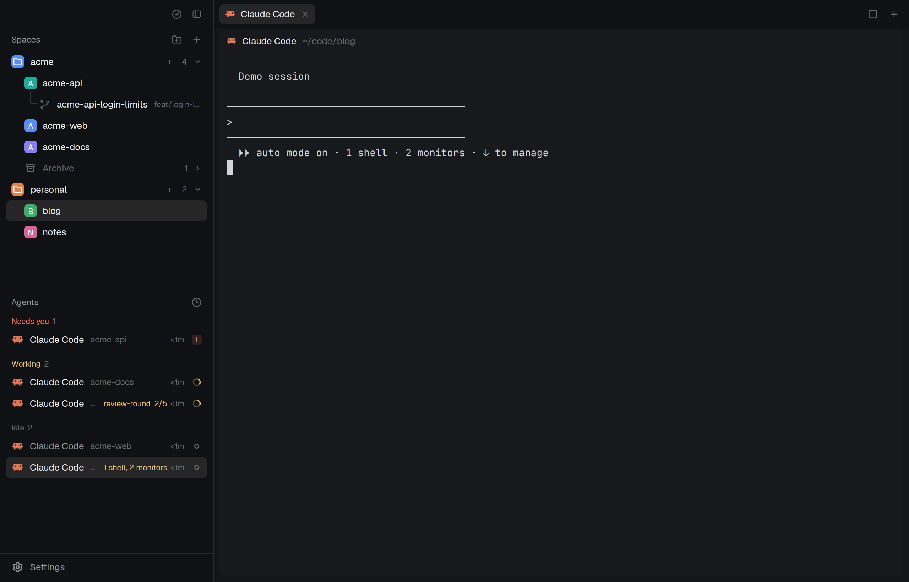

# herdr-mods

The [Herdr T3](https://github.com/JinJieBeWater/herdr-t3) window with two lists changed. Spaces sit in named, colored folders that collect spaces by the directory they work in, and a space can be archived with its tabs and restored later. Agents are sorted by what needs you first, and a Claude Code agent that reads as idle still shows what runs behind it (`1 shell, 2 monitors`) and each running workflow with its steps done (`review-round 2/5`).



# Short instructions for your AI agent

```text
Read https://github.com/Danipulok/herdr-mods and install it into my Herdr app, with the requirements its README lists
```

## What you see

The window is herdr-t3's, as its [recipe](https://github.com/JinJieBeWater/herdr-t3/blob/8b8506341a3aa285041f32e757bd48ef67c916bb/RECIPE.md) describes: brand bar, sidebar, tabs, panes, agent view. Only the two lists in the sidebar's Lists half differ, split 1:1, each at least 90px.

- **Spaces** (`folders` mod), top to bottom:
  - A heading `Spaces` (12px medium, `muted`) with two buttons at the right: New folder (`folder-plus`) and New space (`plus`).
  - Each folder as a 30px head: an 18px rounded tile in the folder's color with a white folder glyph, the name, then a `+` (new space in this folder), the count of its spaces and a chevron. Colors: `#22a99a`, `#e3814f`, `#5b8def`, `#8b7cf6`, `#3fae6a`, `#d9649a`, or grey for none. Folded, the head also shows the most urgent agent state of its spaces (a spinner or a dot).
  - Under an open folder, its spaces as 30px rows indented 26px: an 18px colored square avatar with the space's initial, the name (at most 150px), and only unusual git info at the right (`repo · branch`, `↑2` in green, `↓1` in red, with `main` and `master` left out). A linked worktree sits under its checkout with tree lines and a branch glyph in place of the avatar.
  - At a folder's end, an `Archive N` row (archive glyph, dim) when it holds archived spaces. Open, it lists them newest first with their age (`3d`).
  - Spaces in no folder come after the folders, then their own archived spaces. Another machine gets its own header, or sits inside the first folder whose rules match its name or one of its spaces' folders.
  - Narrower than 160px, the list draws the compact rail of avatars instead.
- **Agents** (`agent-list` mod):
  - A heading `Agents` with a 26px sort button (clock icon for Priority, layers for Grouped by space).
  - By priority: sections `Needs you` (`blocked` color), `Done` (`done`), `Working` (`working`), `Background` (`working`, idle and done agents whose footer still counts a shell, monitor or workflow) and `Idle` (dim), each with its count. Idle starts folded. Grouped: one section per space, named after it.
  - A 30px row per agent: the program icon, what it is on (its named tab, a telling title, else the program), its space dim when the section does not say it, the machine for a remote agent, then the background counts and workflows in the `working` color, the time in its state (`<1m`, `5m`, `3h`, `2d`), and a 14px state mark flush right.
  - Sub-agents indented 20px per level under their parent, with tree lines.

## How it behaves

- **Agent statuses**: working is a spinner in `working`, blocked a 14px `!` badge on `blocked` at 15%, done a 7px `done` dot, idle a 1.5px ring. A parent reads with its live sub-agents: blocked if any of them is, then its own done, then working if any is. Folded parents still show a blocked sub-agent under them. A done agent you look at stays in Done until you leave it.
- **Background work**: every 5s the list reads each agent's screen (`hc read`) and takes the lines under the last `─` rule. For an idle or done agent the counts there (`1 shell`, `2 monitors`) show in its row. For any agent, each line like `◯ name ░░▓▓ 2/5` shows as the workflow name and `2/5`.
- **Agent rows**: click runs `agent.focus`. Hover swaps the time for a pin button. Pinned agents go into a `Pinned` group on top. Pins are the shared state `agents.pins`, the same list herdr-t3's inbox uses. A parent's fold arrow folds its sub-agents and shows their count.
- **Folders**:
  - Click a head to fold it. Drag a head to reorder folders.
  - Right-click a head: color swatches, New space here, Edit folder…, Delete folder. After a delete, its spaces go where the other folders' rules put them, and its archived spaces stay in no folder.
  - Edit folder (dialog 460 wide): Name, "Start new spaces in" (one folder, with Choose… and completion hints), "Collect spaces from" (comma-separated rules, it follows the start folder until edited). Tab and Shift+Tab move between fields. Up, Down and Tab work the hints. A path that is not a folder shows an error in red.
  - A rule matches the directory a space works in: `~` is any home, `*` is one folder name, and a bare name (`web`) matches at any depth. The deepest match wins. A space dropped into a folder by hand stays there.
- **Spaces**:
  - Click selects. Drag onto another space to move it there and into that folder. While dragging, a zone "Drop here to take it out of its folder" shows.
  - Hover shows an archive button. On a checkout, the avatar turns into the fold arrow for its worktrees. A red `↓N` pulls on click.
  - Right-click: color swatches with an automatic one, Edit space… (name and a pinned folder, empty means follow its terminals, filled from where its last Claude Code session started), Git pull, New worktree, Open worktree, Remove worktree (linked ones only), Archive, Close (red).
  - A space made from the front one (keys, palette) lands right under it in the same folder. A space made from a folder's `+` joins that folder. Closing the front space selects the one above it.
- **Archive and restore**: Archive records each tab's name, folder and Claude Code session, then closes the space. On hover an archived row's age turns into a restore button. Restore checks each folder still exists, opens the space and its tabs, and runs `claude --resume <session>` where a session was recorded. Delete is in the right-click menu. Archiving a space or restoring one folds that archive.
- **Keys** (`keys.json`, section `layout:my-t3`): `alt-down`, `ctrl-shift-pagedown`, `ctrl-space shift-n` step to the next space in list order, skipping folded folders. `alt-up`, `ctrl-shift-pageup`, `ctrl-space shift-p` step back. `cmd-shift-w`, `ctrl-shift-w` archive the front space. herdr-t3's `cmd-shift-b`, `cmd-shift-a` and `cmd-shift-s` work as there. `ctrl-v` pastes into the terminal and `ctrl-shift-t` opens a new tab.

## Built from

- `layouts/my-t3.json`: herdr-t3's `layouts/herdr-t3.json` at `8b85063` with two blocks changed: `spaces` holds `{ "mod": "folders" }` and `agents` holds `{ "mod": "agent-list" }`. Node ids stay the same.
- `mods/folders`: a clone of Herdr's shipped `spaces` mod (`0.1.10`) with folders from [herdr-space-folders](https://github.com/jankeesvw/herdr-space-folders) and herdr-t3's `t3-spaces` changes. Own icons `trash.svg` and `archive-restore.svg`. Commands it runs: `space.new`, `space.select`, `space.move`, `space.rename`, `space.close`, `tab.new`, `agent.focus`, `layout.select`. Shared state `space-folders` and `folders.job`. Worktree dialogs come from the shipped `worktree` mod.
- `mods/agent-list`: a clone of Herdr's shipped `agents` mod (`0.1.10`) through herdr-t3's `t3-agents`, with `name.js` and `tree.js` copied from it. Commands: `agent.focus`, `terminal.peek`. Shared state `agents.sort`, `agents.pins`.
- Shipped mods used: `worktree`, `picker`, `menu`, and icons from `mods/workspace-chrome/`.
- Files: folders live in `~/.config/herdr-space-folders.json` (`list`, `of`, `archive`, `colors`, `pins`, `at`), the file herdr-space-folders uses.

## Watch out

- The layout needs herdr-t3's `t3-chrome`, `t3-tabs`, `t3-inbox`, `t3-pane` and `t3-new-menu` mods, which this repository does not ship. Install [herdr-t3](https://github.com/JinJieBeWater/herdr-t3) first. Its `layouts/herdr-t3.svg` is also this layout's preview.
- Programs run, on the space's machine where it has one: `git status` (with `--no-optional-locks -c core.fsmonitor=false`, so reading does not wake the folder watch again), `git rev-parse`, `git pull --ff-only` on request, `hc read` every 5s per agent, `hc label <agent> herdr.folder=<name>`, `hc machine ls --json`, `test -d`, `grep`, `ls -d` for path hints, and `sh -c` to read and write the folders file. The worktree dialogs run whatever the shipped `worktree` mod runs.
- Files read outside the mods: `~/.config/herdr-space-folders.json`, ccgram's `~/.ccgram/session_map.json` and the transcripts it names (for Restore), and `${XDG_STATE_HOME:-~/.local/state}/claude-hc-resume/` (for Edit space). Without ccgram, Restore opens a plain terminal in the same folder.
- The folders file is written through a `.tmp` file and `mv`. A newer file on disk wins, so another writer of it (herdr-space-folders) does not lose its changes. It is re-read every 15s and on change.
- The background counts and workflows are parsed from Claude Code's footer text. A Claude Code release that changes that footer leaves them empty.
- The core turns a stand-in agent's `done` into `idle` within seconds, so a fake agent tests Done poorly. Use a real agent.

## Done when

- `herdr-app check` passes for `mods/folders` and `mods/agent-list`, and `layout.switch {"name": "my-t3"}` shows the window above.
- New folder, then Edit folder with a start folder: `+` on its head opens a space there, and an existing space working under a matching rule moves into it.
- `alt-down` and `alt-up` walk the spaces in list order and skip a folded folder.
- `ctrl-shift-w` archives the front space, and its `Archive 1` row restores it with the same tabs.
- An agent asking a question shows under `Needs you` with the `!` badge. A Claude Code agent with a background shell shows `1 shell` once idle.
